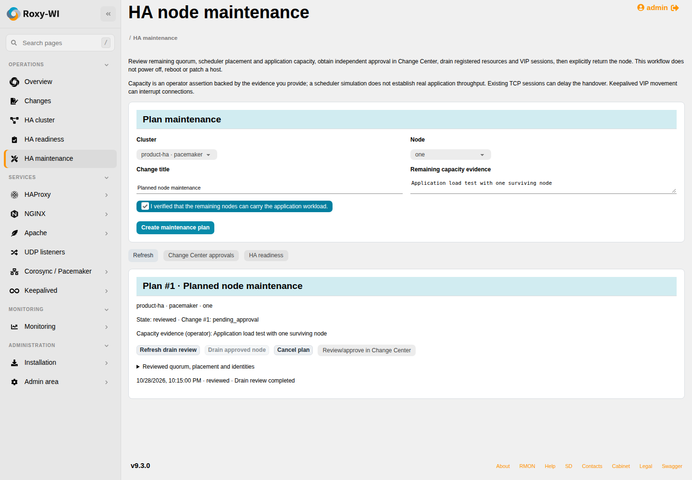

# Reviewed HA node maintenance

Open **Operations → HA maintenance**. This workflow manages registered cluster
resources and VIPs; it does not power off, reboot, patch or reinstall a machine.
It uses the existing **Premium Change Center** entitlement and Cluster service
permission. Every drain and return needs approval by another administrator.

## Workflow

1. Select the cluster/member, supply a change title and record evidence that the
   remaining nodes can carry the application load. A scheduler's placement
   prediction does not establish real application throughput.
2. Create the plan and select **Review drain**. This is a durable read-only
   Operations job. Inspect quorum, placement, identities and capacity evidence.
3. A different enabled administrator with Cluster permission approves the review
   in Change Center. The author cannot approve it. Use **Drain approved node**
   from the maintenance wizard; ordinary configuration-deployment actions cannot
   execute this operational change.
4. The worker rechecks permissions, approval, membership/SSH identities and the
   reviewed configuration before the write. It then waits for resource/VIP
   movement and established sessions on the detected VIPs to drain.
5. **ready** means registered resources and detected VIP sessions were observed
   drained. The node is handed over for the external maintenance procedure.
6. When the member is reachable and healthy again, select **Review return**.
   Review current placement and configuration and obtain a new independent
   approval. **Return approved node** restores its eligibility/service and
   verifies the cluster. Resources need not move back to that particular node.

Protected servers require an administrator to execute the drain/return. Capacity
remains an operator assertion and is shown as such. Existing connections may keep
a node draining; a timeout never becomes a successful handover.

## Pacemaker

The review checks the remaining vote weight against the actual quorum threshold,
working TLS/witness votes when applicable, fencing enabled, cluster maintenance
mode off and managed active resources. The fixed helper simulates standby against
a private offline copy of the live CIB using crm_simulate and reads its resulting
crm_mon state. It refuses loss of a workload's last active instance or promoted
role and requires the selected node to be empty. Actual observations after the
write independently recheck the resulting resource state.

The only live eligibility write is crm_standby for the selected registered member.
The cluster remains reserved while a node is handed over: CIB/membership changes,
witness migrations, certificate deployments and other mutations using its common
lock must wait. Read-only status and health monitoring remain available. No
cluster-owned proxy is started/stopped independently.

Session drain covers static IPaddr/IPaddr2 addresses, including resolvable CIB
templates and attribute references. Conditional/unresolved VIP addresses are
refused. This does not prove application-level transaction completion or drain
arbitrary third-party resource agents' private protocols. Clone instance counts
may decrease during maintenance; the operator's capacity assertion must cover it.

## Keepalived

Independent Keepalived Auto Start must be disabled. Every registered VIP must
initially have one owner and all members must be reachable. The workflow stops
Keepalived on the selected node, verifies that its VIPs moved to surviving members
and waits for detected VIP TCP sessions to close. VIP movement can interrupt
connections. It does not implement VRRP quorum or fencing.

Return starts the same saved native/container binding and checks unique VIP
ownership and member service activity. A failed takeover with a missing VIP can
be recovered by a newly reviewed return; duplicate VIP owners are refused.
Included custom Keepalived files need separate configuration review before this
automatic workflow can establish its supported scope. Service lifecycle controls
and HA reconfiguration cannot compete with an active reservation.

## Interrupted work and evidence

A failed or interrupted mutation is never silently replayed. The plan stays
unknown/draining and no handover is reported. Use **Verify drain** to re-observe
without repeating the write, or **Review return** for a new reviewed recovery.
The reservation cannot be cancelled after handover; it must be explicitly
returned. Member identity/configuration drift invalidates the earlier approval.
Private host errors are not included in plan events.

A successfully observed drain **and** return creates a configuration-bound
`planned-node-maintenance` record visible in HA readiness, with operation/plan
identifiers and both timestamps. Recovery after an unverified drain does not
create successful-test evidence. A planned maintenance result never establishes
fencing or network-partition safety; older configuration evidence is labelled
stale after drift.

## API and storage

Migration `20261028020000_ha_maintenance` adds encrypted plan state. Existing
Change Center records hold review/approval metadata and retain their normal
group isolation and self-approval restriction.

| Endpoint | Action |
| --- | --- |
| `GET /ha/api/maintenance` | Active-group plan history |
| `POST /ha/api/maintenance` | Create provider/cluster/node/title/capacity plan |
| `POST /ha/api/maintenance/ID/review` | Review drain |
| `POST …/drain` | Execute the approved drain |
| `POST …/verify` | Observe an uncertain drain without replay |
| `POST …/review-return` | Review a return/recovery and reset approval |
| `POST …/resume` | Execute the approved return |

Roles 1–3 may operate plans; protected-node writes and independent approvals need
roles 1–2. Mutations use existing JWT/CSRF. Worker permission and identity checks
apply again after queuing. HTTP 202 means queued, not completed.

## Verification boundary

Local tests use authenticated API/database/Chromium workflows and real offline
Pacemaker 2.1.6 CLI tools on isolated Ubuntu 24.04 ARM64. They cover approval,
quorum budget, surviving placement, handover/return, connection delays, failed
commands, drift, group/role changes, Keepalived takeover recovery and interruption
handling. The scheduler checks are part of GitHub's Linux integration job.
On 29 October 2026, actual drain and return workflows completed on Debian 13.7 /
Pacemaker 3.0.0 and Rocky Linux 9.8 / Pacemaker 2.1.10. The author's self-approval
returned HTTP 403 and an unapproved drain HTTP 409. A separate authenticated
editor approved the drain; the worker set standby, observed no active resources
on the selected member and retained quorum. Return review cleared approval; a
second independent approval allowed resume. Both plans completed with all members
online and outside standby, and the readiness page recorded the observed result.
The capacity statement described disposable lab workloads, not production load.
An additional independently approved drain preceded actual reboots of the second
Debian and Rocky members. Fresh guest boot times were verified, followed by new
return reviews, separate approvals and completed returns. NGINX and HAProxy
autostart were observed on both rebooted members.

A separate native Keepalived pair (Debian 13.7 and Rocky Linux 9.8) used only an
isolated RFC5737 network and test VIP. Its author could not self-approve or drain
without approval. The approved drain moved the VIP to the other member; TLS
trust, hostname, certificate fingerprint and HTTP 200 were verified through the
VIP. A newly reviewed, independently approved return completed with both services
active and exactly one VIP owner. HA readiness recorded the observed result.
These planned handovers do not qualify network partitions, physical fencing,
uninterrupted existing connections or production workload capacity.

The external entitlement adapter was used only to test PRs #443–#452. Login,
roles, independent approvals, SSH and actual cluster operations remained real;
the real subscription service was not qualified.

Offline simulation follows the official
[Pacemaker scheduler tool](https://github.com/ClusterLabs/pacemaker/blob/main/tools/crm_simulate.c).
