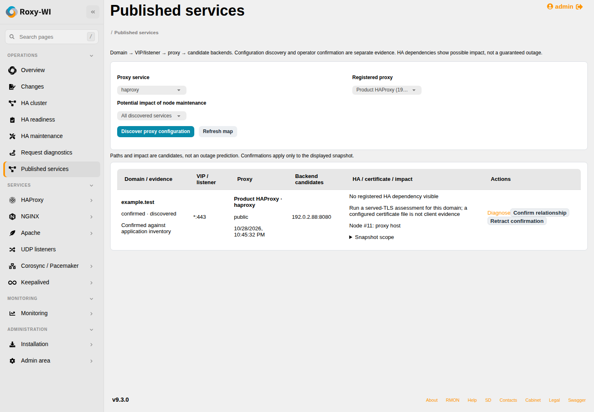

# Published-service map

Open **Operations → Published services**. Select a registered HAProxy, NGINX or
Apache proxy and **Discover proxy configuration**. The durable Operations job
reads its configuration and interface addresses; discovery sends no application
traffic and changes no remote files. Repeat for each proxy you want on the map.

The group-wide table links **domain → VIP/listener → proxy → candidate backends**.
Wildcard listeners are not VIPs: host interface addresses and registered
Keepalived VIPs are separately labelled. Literal Host ACLs/server names are
discovered; dynamic rules, regexes, maps and conditional routes are not evaluated
as though they were active request routing. Partial inventories are marked.
The [diagnostic guide](proxy-diagnostics.md) documents shared parser limits,
include handling, runtime ownership and configuration-versus-loaded-state limits.

## Evidence and confirmation

Every row includes its discovery time, configuration fingerprint, current
server/runtime identity and source scope. This is a saved snapshot, not continuous
live monitoring. **Refresh map** reads saved evidence; **Discover proxy
configuration** obtains new evidence. A failed refresh retains the preceding
successful snapshot. Its timestamp remains visible; Operations shows the failure.

**Confirm relationship** records the operator, time and reason for a domain on an
already discovered frontend. A manually supplied domain remains
**operator-supplied**, even after confirmation. Confirmation never rewrites proxy
configuration and does not prove DNS, traffic, TLS delivery or failover. It applies
only to that snapshot and must be renewed after a new discovery. Changed server,
SSH credential or container binding blocks confirmation until rediscovery.
**Retract confirmation** removes the annotation. Guest role 4 may read saved
evidence; roles 1–3 with the corresponding proxy service may discover/confirm.
All data and worker permission rechecks remain scoped to the active group.

## Node impact

Select a registered node in **Potential impact of node maintenance** to
filter services depending on that node. The choices include registered backend nodes in the same group. Dependencies include the proxy itself, literal
backend IP matches and registered Keepalived/Pacemaker membership (HA service
permission required). They are potential dependencies, not outage predictions:
failover or redundant backends can preserve service. Current Pacemaker resource
placement and arbitrary dynamic backend DNS are not inferred.

Use **Diagnose** for live request-path evidence. The map includes matching [served-TLS evidence](served-tls.md) by domain and node,
with its time, fingerprint and expectation freshness. Configured PEM files alone
do not establish what clients see.
No private keys, full ACL conditions, certificate paths or credentials appear in
the publication metadata. Reports are encrypted with the normal credential key.

## API and limits

- `GET /insights/api/services?impact_node=ID`: latest successful snapshot per
  proxy/service visible to the caller, with confirmation and potential impact.
- `POST /insights/api/services/discover`: `{service, server_id}`, returns
  assessment/task IDs; poll `GET /insights/api/assessments/ID`.
- `POST /insights/api/services/confirm`: `{assessment_id, frontend_id, domain,
  note}`; superseded or identity-changed snapshots are rejected.
- `DELETE /insights/api/services/confirm/ID`: retract a visible confirmation.

At most 256 proxy bindings are returned per group, 128 frontends per binding,
64 backend candidates per frontend and 1024 confirmations per snapshot.
Oversized inventories fail explicitly instead of silently claiming completeness.
There is no automatic application configuration mutation from this feature.

## Verification

Automated database/API tests cover encrypted discovery, confirmation/retraction,
manual-domain provenance, superseded snapshots, permission/tenant boundaries,
identity drift, failed refresh and proxy/HA/backend impact. Chromium exercises
the native controls and mobile overflow; the illustration above uses synthetic data.

On 29 October 2026, actual configuration discovery on Debian 13.7 and Rocky
Linux 9.8 HAProxy/Podman hosts found the lab domain's HTTP/TLS frontends, listeners
and backend. Independent HTTPS and backend diagnostics verified the fixture.
Relationships were then confirmed through the authenticated API and the node
impact filter returned the corresponding confirmed publications. The TLS monitor
was rebound through the GUI to the latest discoveries after configuration changes.
This is observed proxy/domain/backend evidence, not a proof of arbitrary
conditional routing or physical HA dependency independence.
